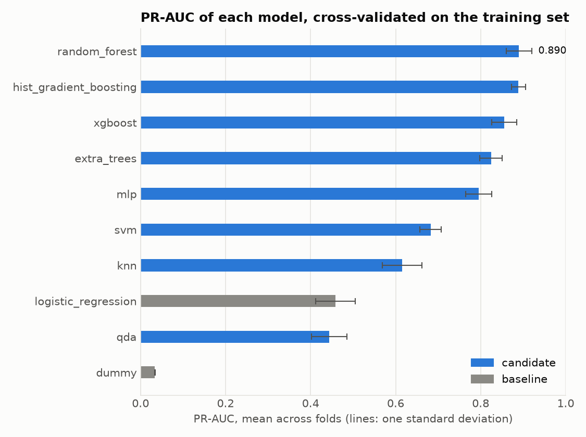
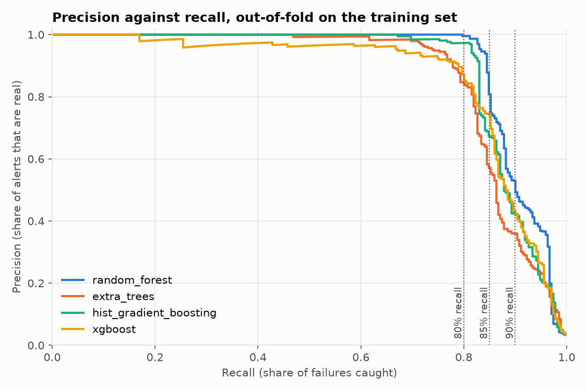

# Model selection

How the final model was chosen, on the training set only: baselines, a comparison
of ten models, a feature-set comparison, tuning of the four best models with
nested cross-validation, and the choice of a decision threshold. Back to the
[README](../README.md).

## Baselines

```bash
uv run mf compare --models dummy logistic_regression
```

Cross-validates a dummy classifier (always predicts "no failure") and a
class-weighted logistic regression on the training set, and prints the mean and
standard deviation of each metric. The test set is not used. Use `--repeats N`
to repeat the cross-validation with different shuffles for steadier estimates.

Results at the time of writing (5-fold, 8,000 training rows, 271 failures):

| Model               | PR-AUC        | ROC-AUC       | Recall        | Precision     |
| ------------------- | ------------- | ------------- | ------------- | ------------- |
| Dummy               | 0.034 ± 0.000 | 0.500 ± 0.000 | 0.000 ± 0.000 | 0.000 ± 0.000 |
| Logistic regression | 0.459 ± 0.047 | 0.923 ± 0.015 | 0.841 ± 0.051 | 0.162 ± 0.009 |

The dummy reaches 96.6% accuracy while catching no failures, which is why
accuracy is not used to compare models. Logistic regression catches most
failures at the default threshold, but most of its alerts are false alarms; the
PR-AUC of about 0.46 is the bar later models need to beat.

## Model comparison

```bash
uv run mf compare
```

Cross-validates the two baselines and eight candidate models on the same
training folds and prints one table, ordered by mean PR-AUC. It takes about a
minute. The test set is not used. Use `--repeats N` for steadier estimates and
`--models a b c` to compare only some models. `--config FILE.toml` reads the
settings from a file (see `configs/`); the options override it. In Python, use
`ComparisonPipeline(config).run()`, which returns the table and a description of the
run. `--plot FILE` also saves the comparison as a bar chart:



The candidates are random forest, extra trees, histogram gradient boosting,
XGBoost, KNN, SVM, an MLP and quadratic discriminant analysis, all behind the
shared preprocessing pipeline with default settings and no tuning. Models that
support it weight the classes inversely to their frequency (random forest, extra
trees, gradient boosting and SVM; XGBoost through `scale_pos_weight`).

Results at the time of writing (5-fold, 8,000 training rows, 271 failures; mean
± standard deviation across folds):

| Model                  | PR-AUC        | ROC-AUC       | Recall        | Precision     | F1            |
| ---------------------- | ------------- | ------------- | ------------- | ------------- | ------------- |
| random_forest          | 0.890 ± 0.030 | 0.971 ± 0.014 | 0.749 ± 0.057 | 0.985 ± 0.014 | 0.850 ± 0.040 |
| hist_gradient_boosting | 0.889 ± 0.017 | 0.971 ± 0.009 | 0.823 ± 0.034 | 0.899 ± 0.052 | 0.858 ± 0.023 |
| xgboost                | 0.855 ± 0.029 | 0.971 ± 0.012 | 0.801 ± 0.027 | 0.828 ± 0.015 | 0.814 ± 0.015 |
| extra_trees            | 0.824 ± 0.026 | 0.971 ± 0.011 | 0.546 ± 0.055 | 0.947 ± 0.030 | 0.692 ± 0.051 |
| mlp                    | 0.795 ± 0.031 | 0.971 ± 0.011 | 0.668 ± 0.047 | 0.783 ± 0.081 | 0.719 ± 0.043 |
| svm                    | 0.682 ± 0.025 | 0.962 ± 0.011 | 0.871 ± 0.048 | 0.309 ± 0.020 | 0.455 ± 0.024 |
| knn                    | 0.615 ± 0.047 | 0.915 ± 0.011 | 0.240 ± 0.030 | 0.918 ± 0.073 | 0.380 ± 0.041 |
| logistic_regression    | 0.459 ± 0.047 | 0.923 ± 0.015 | 0.841 ± 0.051 | 0.162 ± 0.009 | 0.271 ± 0.012 |
| qda                    | 0.444 ± 0.042 | 0.923 ± 0.015 | 0.362 ± 0.030 | 0.561 ± 0.038 | 0.439 ± 0.030 |
| dummy                  | 0.034 ± 0.000 | 0.500 ± 0.000 | 0.000 ± 0.000 | 0.000 ± 0.000 | 0.000 ± 0.000 |

How to read it:

- Random forest and gradient boosting are tied on PR-AUC. Their gap is far
  smaller than the spread across folds, so this comparison cannot separate them.
  Both roughly double the logistic regression baseline.
- XGBoost is third, about 0.035 behind them, which is roughly one standard
  deviation. It has the most balanced precision and recall of the three at the
  default threshold. It has many settings that were not tuned here.
- Precision, recall and F1 use the default 0.5 threshold. Random forest is very
  precise but misses about a quarter of the failures, while gradient boosting
  finds more of them with somewhat lower precision. Choosing the decision
  threshold is a separate step.
- ROC-AUC is nearly identical for the four best models, while PR-AUC ranks them,
  which is why PR-AUC is the main metric.
- These are default settings with no tuning, so close rankings may change.

## Feature set comparison

```bash
uv run mf compare --feature-sets raw computed all
```

(`--models a b c` limits it to some models; `--metric` chooses the metric shown.)

Cross-validates all 10 models on each of three feature sets, on the same
training folds, and prints one table with the models as rows and the feature
sets as columns. It takes about four minutes and reports progress on stderr. The
test set is not used. Use `--metric` to show another metric (default `pr_auc`)
and `--repeats N` for steadier estimates.

- `raw`: `Type` and the five measurements (6 features)
- `computed`: `temp_diff`, `power` and `strain` only (3 features)
- `all`: the raw and computed features together (9 features)

PR-AUC at the time of writing (5-fold, 8,000 training rows, 271 failures; mean
± standard deviation across folds):

| Model                  | raw           | computed      | all           |
| ---------------------- | ------------- | ------------- | ------------- |
| random_forest          | 0.755 ± 0.037 | 0.730 ± 0.045 | 0.890 ± 0.030 |
| hist_gradient_boosting | 0.793 ± 0.044 | 0.702 ± 0.067 | 0.889 ± 0.017 |
| xgboost                | 0.779 ± 0.055 | 0.603 ± 0.055 | 0.855 ± 0.029 |
| extra_trees            | 0.696 ± 0.026 | 0.629 ± 0.058 | 0.824 ± 0.026 |
| mlp                    | 0.733 ± 0.022 | 0.681 ± 0.066 | 0.795 ± 0.031 |
| svm                    | 0.661 ± 0.025 | 0.542 ± 0.077 | 0.682 ± 0.025 |
| knn                    | 0.517 ± 0.027 | 0.556 ± 0.086 | 0.615 ± 0.047 |
| qda                    | 0.373 ± 0.042 | 0.555 ± 0.080 | 0.444 ± 0.042 |
| logistic_regression    | 0.441 ± 0.033 | 0.324 ± 0.038 | 0.459 ± 0.047 |
| dummy                  | 0.034 ± 0.000 | 0.034 ± 0.000 | 0.034 ± 0.000 |

How to read it:

- The derived features clearly help the tree-based models. Going from `raw` to
  `all` raises PR-AUC by about 0.14 for random forest, 0.13 for extra trees, 0.10
  for gradient boosting and 0.08 for XGBoost, several times the spread across
  folds. The best results, random forest and gradient boosting at about 0.89,
  both use all 9 features.
- Logistic regression and SVM gain only 0.02, which is within the spread. A
  plausible reason is that linear models cannot use threshold effects even when
  given the combined quantities; this has not been tested.
- The three computed features alone nearly match the raw features for random
  forest (0.73 against 0.76), but combining them with the raw columns is better
  than either. QDA is the exception and does best on the computed features alone.
- Based on this, the remaining steps use all 9 features.

## Hyperparameter tuning

```bash
uv run mf tune --n-jobs 4
```

Tunes four models with randomized search and compares each with its default
settings. For every model it scores the defaults, estimates the tuned model with
nested cross-validation, and runs one search on the whole training set to find
the setting to use. It uses the training set only and all 9 features, and takes
about 20 minutes on 4 cores. Options: `--models` (a subset), `--n-iter` (random
settings per search, default 20), `--inner-splits` (default 3), `--repeats` and
`--n-jobs`.

**Why these four models.** The search is the expensive step, and the more
settings are compared on 271 failures, the more likely it is that the "best" one
is just the luckiest. So only the most promising models are tuned, chosen from
the default-settings comparison above:

- Random forest, histogram gradient boosting and XGBoost are the top three by
  PR-AUC (0.890, 0.889 and 0.855).
- Extra trees is next (0.824), a cheap relative of random forest.
- The MLP (0.795) ranks fifth, has no class-weight option and many more
  settings to tune, so it was left out to keep the search small. SVM and KNN
  (0.68 and 0.62) and logistic regression and QDA (about 0.45) are far behind.
  The feature-set comparison also showed that all 9 features are best for the
  tree-based models.

The search spaces are defined on the model classes (`Model.search_space`,
`models/candidates.py`) and collected in `models/search_spaces.py`. Each contains the default setting,
so the untuned model is always one of the options, and the class-imbalance
setting is part of the search (class weights, or `scale_pos_weight` for
XGBoost).

**How the tuned scores are estimated.** In each of the 5 outer folds the search
runs on that fold's training part only, with its own 3-fold cross-validation,
and the setting it picks is scored on the held-out fold. The best score a search
reports for itself is optimistic, because the setting was picked on those same
folds; the nested scores are not. They use the same outer folds as the untuned
models, so the two are directly comparable.

Results at the time of writing (5 outer folds, 8,000 training rows, 271
failures; mean ± standard deviation across folds):

| Model                            | PR-AUC        | ROC-AUC       | Recall        | Precision     | F1            |
| -------------------------------- | ------------- | ------------- | ------------- | ------------- | ------------- |
| random_forest (default)          | 0.890 ± 0.030 | 0.971 ± 0.014 | 0.749 ± 0.057 | 0.985 ± 0.014 | 0.850 ± 0.040 |
| random_forest (tuned)            | 0.911 ± 0.025 | 0.978 ± 0.017 | 0.819 ± 0.042 | 0.987 ± 0.012 | 0.895 ± 0.024 |
| hist_gradient_boosting (default) | 0.889 ± 0.017 | 0.971 ± 0.009 | 0.823 ± 0.034 | 0.899 ± 0.052 | 0.858 ± 0.023 |
| hist_gradient_boosting (tuned)   | 0.893 ± 0.022 | 0.975 ± 0.012 | 0.819 ± 0.034 | 0.923 ± 0.036 | 0.867 ± 0.024 |
| extra_trees (default)            | 0.824 ± 0.026 | 0.971 ± 0.011 | 0.546 ± 0.055 | 0.947 ± 0.030 | 0.692 ± 0.051 |
| extra_trees (tuned)              | 0.873 ± 0.028 | 0.976 ± 0.018 | 0.764 ± 0.050 | 0.911 ± 0.045 | 0.829 ± 0.023 |
| xgboost (default)                | 0.855 ± 0.029 | 0.971 ± 0.012 | 0.801 ± 0.027 | 0.828 ± 0.015 | 0.814 ± 0.015 |
| xgboost (tuned)                  | 0.870 ± 0.034 | 0.980 ± 0.014 | 0.808 ± 0.044 | 0.842 ± 0.041 | 0.823 ± 0.018 |

Best settings found by the search on the whole training set:

| Model                  | Settings                                                                                                                  |
| ---------------------- | ------------------------------------------------------------------------------------------------------------------------- |
| random_forest          | 500 trees, `max_depth` 8, `min_samples_leaf` 2, `max_features` 0.8, no class weights                                      |
| extra_trees            | 300 trees, no depth limit, `min_samples_leaf` 5, `max_features` 0.8, no class weights                                     |
| hist_gradient_boosting | `learning_rate` 0.1, 100 iterations, 31 leaf nodes, `min_samples_leaf` 20, `l2_regularization` 0.1, balanced class weights |
| xgboost                | 300 trees, `learning_rate` 0.05, `max_depth` 6, `min_child_weight` 1, `scale_pos_weight` 5, no subsampling                 |

How to read it:

- Tuning helps modestly. Extra trees gains the most (+0.05 PR-AUC, more than its
  spread). Random forest gains 0.02 and XGBoost 0.015, within one spread, and
  gradient boosting about 0.004, so its defaults were already close to its best.
- Random forest is first at 0.911 and gradient boosting second at 0.893, but the
  gap is smaller than the spread across folds, so this comparison does not
  clearly separate them. Extra trees and XGBoost are tied behind them.
- Strong class weighting was not needed for PR-AUC: the best random forest and
  extra trees use none, and XGBoost prefers a weight of 5 over about 28.
- For every model the search's own best score is within 0.001 of the nested
  estimate, so picking the best of 20 settings barely inflated it here.
- This is one run with one seed and 20 settings per model. Precision, recall and
  F1 still use the default 0.5 threshold; choosing the threshold is a separate
  step.

## Threshold tuning

A model gives each machine a failure probability, and a machine is flagged when
its probability is at least the **threshold**. A low threshold catches more
failures (high recall) but raises more false alarms (low precision); a high one
does the opposite. The default of 0.5 is arbitrary, so this step shows the
trade-off for the four tuned models and what each recall target costs.

```bash
uv run mf thresholds --plot pr_curves.png
```

It uses the training set only; the test set is not touched. Options: `--targets`
(recall targets to compare, default `0.80 0.85 0.90`) and `--plot FILE` (save the
precision-recall curves as a PNG). It takes about a minute.



How it works:

- The four winning configurations from the tuning step are the
  `Model.tuned_settings` of the model classes, collected in `models/tuned.py`
  (`build_tuned_models`).
- `evaluation/predictions.py` gives every training row a failure probability from a model
  that never saw it (`out_of_fold_predictions`): stratified 5-fold, the same
  folds as the cross-validation elsewhere. These probabilities behave like
  predictions on new data, so a threshold chosen on them is not tuned on the
  data the model was trained on.
- `evaluation/thresholds.py` computes the counts (TP, FP, FN, TN), precision, recall and F1
  at every threshold, and finds the highest threshold that reaches a recall
  target, which is the one with the fewest false alarms.

Results (out-of-fold on the 8,000 training rows, 271 failures). For each recall
target, the highest threshold that reaches it:

| Recall target | Model                  | Threshold | Correct alerts | False alarms | Missed | Precision |    F1 |
| ------------- | ---------------------- | --------: | -------------: | -----------: | -----: | --------: | ----: |
| 80%           | random_forest          |     0.657 |            217 |            1 |     54 |     0.995 | 0.888 |
|               | hist_gradient_boosting |     0.923 |            217 |            6 |     54 |     0.973 | 0.879 |
|               | xgboost                |     0.495 |            217 |           32 |     54 |     0.871 | 0.835 |
|               | extra_trees            |     0.328 |            217 |           39 |     54 |     0.848 | 0.824 |
| 85%           | random_forest          |     0.147 |            231 |           55 |     40 |     0.808 | 0.829 |
|               | xgboost                |     0.199 |            231 |           80 |     40 |     0.743 | 0.794 |
|               | hist_gradient_boosting |     0.100 |            231 |          112 |     40 |     0.673 | 0.752 |
|               | extra_trees            |     0.148 |            231 |          173 |     40 |     0.572 | 0.684 |
| 90%           | random_forest          |     0.060 |            244 |          216 |     27 |     0.530 | 0.668 |
|               | xgboost                |     0.027 |            244 |          320 |     27 |     0.433 | 0.584 |
|               | hist_gradient_boosting |     0.008 |            244 |          331 |     27 |     0.424 | 0.577 |
|               | extra_trees            |     0.068 |            244 |          433 |     27 |     0.360 | 0.515 |

At the threshold with the best F1:

| Model                  | Threshold | Recall | Precision |    F1 | False alarms |
| ---------------------- | --------: | -----: | --------: | ----: | -----------: |
| random_forest          |     0.475 |  0.827 |     0.987 | 0.900 |            3 |
| hist_gradient_boosting |     0.864 |  0.815 |     0.969 | 0.886 |            7 |
| extra_trees            |     0.416 |  0.764 |     0.945 | 0.845 |           12 |
| xgboost                |     0.654 |  0.790 |     0.907 | 0.844 |           22 |

How to read it:

- Random forest is the best model at every recall target. It was only tied with
  gradient boosting on PR-AUC, but at a fixed recall it has the fewest false
  alarms, and the gap widens as the target rises.
- There is a knee near 83% recall. Up to there, random forest finds failures with
  almost no false alarms (3 false alarms among more than 7,700 normal machines at
  the best-F1 threshold). Beyond it, each extra point of recall is expensive: 85%
  costs about 55 false alarms (81% of alerts real), and 90% costs 216 (about one
  alert in two is false).
- This fits the data: about 13 to 15% of the failures get a probability below 0.1
  from every model. They match the failures the data generation makes random
  (tool wear failures within 200-240 minutes, random failures and failures with no
  recorded cause), so they cannot be caught without flagging many normal machines.
- Thresholds are not comparable across models. Class-weighted models such as
  gradient boosting give failures extra weight when they train, which inflates
  their probabilities (best threshold 0.86, against 0.48 for random forest).
  Compare models at the same recall, not at the same threshold.
- Caveats: the thresholds are chosen on the same out-of-fold predictions they are
  evaluated on, so they are slightly optimistic, and differences of a few false
  alarms between models (for example 1 against 6 at 80% recall) are within noise.
  The larger gaps at 85% and 90% are more convincing.

The choice of model and operating point (which recall to aim for) depends on how
costly a false alarm is compared with a missed failure. The final evaluation
uses random forest at its best-F1 threshold, 0.475 (about 83% recall with almost
no false alarms). A threshold near 0.147 would reach 85% recall at the price of
about 55 false alarms on the training data; set `threshold` in a training config
(or `mf train --threshold`) if false alarms are cheaper than missed failures for
your use.

Each tuned model keeps its best-F1 threshold from this table as `Model.threshold`
(`models/candidates.py`), and training uses the threshold of the model it trains,
since thresholds do not carry over between models. The table shows thresholds
rounded to three decimals. For random forest the exact best-F1 threshold is
0.4746, and one out-of-fold failure has a probability between it and 0.475. At
0.475 the out-of-fold recall is therefore 223 of 271 failures (0.823, the
cross-validation column of the final evaluation), against 224 (0.827, this table)
at 0.4746. The final model keeps 0.475, the value chosen before the test set was
used: re-choosing it now would mean evaluating on the test set a second time.
